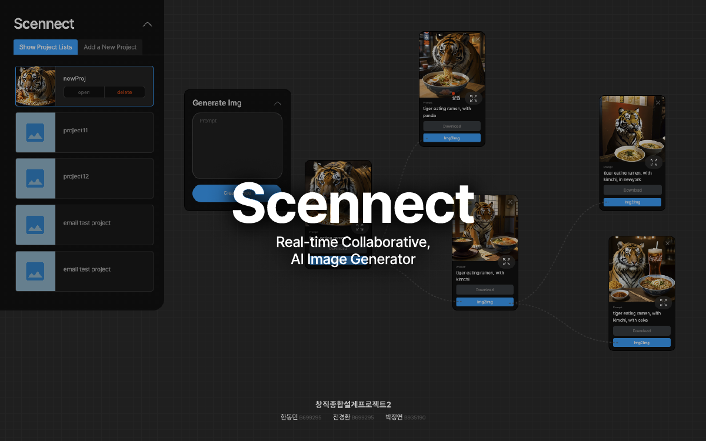
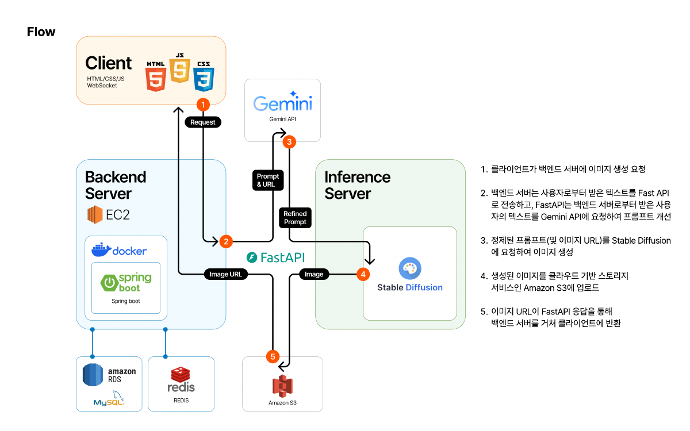

# Scennect

> AI 이미지 생성과 수정 과정을 노드로 연결하는 협업 플랫폼의 이미지 생성·수정 API입니다.



## 왜 Scennect인가

이미지를 여러 번 생성하고 수정할 때는 결과물뿐 아니라 어떤 프롬프트와 이미지에서 다음 결과가 만들어졌는지도 함께 확인할 필요가 있습니다. Scennect는 이 과정을 노드와 트리로 표현하고, 팀원들이 같은 프로젝트에서 작업할 수 있도록 기획한 창직종합설계 팀 프로젝트입니다.

이 저장소는 전체 플랫폼 중 **FastAPI 기반 이미지 생성·수정 API**를 담고 있습니다. 사용자 입력을 Gemini로 가공하고, Stable Diffusion WebUI에 이미지 생성을 요청한 뒤, 결과를 S3에 저장하여 URL을 반환합니다.

## 프로젝트와 저장소 범위

| 구분 | 내용 |
| --- | --- |
| 전체 서비스의 주요 요구사항 | 실시간 협업, 노드 기반 UI, 생성·수정 이력의 트리 시각화, 수정 권한 관리 |
| 이 저장소에 구현된 기능 | 프롬프트 가공, 텍스트 기반 이미지 생성, 기존 이미지 수정, seed 전달, S3 저장 및 URL 반환 |
| 별도 구성 요소 | 프런트엔드, Spring Boot 백엔드, 인증·인가, WebSocket 협업, 프로젝트·노드 DB 관리 |

전체 서비스 요구사항은 발표 자료 기준입니다. 이 저장소만으로 협업 UI와 Spring Boot 서버가 함께 실행되지는 않습니다.

## 아키텍처와 처리 흐름



위 그림은 발표 당시의 전체 서비스 구성입니다. 이 저장소는 그림의 **FastAPI와 외부 서비스 연동 부분**을 담당합니다. 모델 실행과 이미지 추론은 별도로 구동하는 Stable Diffusion WebUI에서 수행합니다.

1. Spring Boot 백엔드가 사용자 입력을 FastAPI에 전달합니다.
2. FastAPI가 Gemini에 영문 이미지 생성 프롬프트 작성을 요청합니다.
3. 생성 요청은 WebUI의 `txt2img`, 수정 요청은 `img2img` API로 전달합니다.
4. WebUI의 Base64 응답을 이미지로 변환하고, 생성에 사용한 seed를 읽습니다.
5. 이미지를 S3에 PNG로 저장하고 URL을 백엔드에 반환합니다.

## 주요 구현

### 프롬프트 가공

`prompt.py`는 사용자의 설명에 이미지 생성용 지시문을 덧붙여 Gemini에 전달합니다. 현재 지시문은 Stable Diffusion 2.0용 영문 프롬프트를 200자 이내로 작성하도록 요청합니다. 이는 모델에 전달하는 지시이며, 응답 길이를 코드로 검증하는 방식은 아닙니다. 실제 이미지 모델은 WebUI에 로드된 체크포인트를 사용합니다.

### 이미지 생성과 수정

- **텍스트 기반 생성:** 가공한 프롬프트를 `/sdapi/v1/txt2img`에 전달합니다.
- **기존 이미지 수정:** 이미지 URL에서 원본을 내려받아 RGB·512×512로 변환하고, Base64로 인코딩해 `/sdapi/v1/img2img`에 전달합니다.
- **seed 선택:** 수정 시 기존 이미지 파일명에서 seed를 추출합니다. `seed_check: true`이면 해당 값을 전달하고, `false`이면 `-1`을 전달해 새 seed를 사용하도록 요청합니다. 같은 seed만으로 동일한 결과가 보장되는 것은 아닙니다.

현재 `services.py`의 요청 설정은 다음과 같습니다.

| 설정 | 값 |
| --- | --- |
| 이미지 크기 | 512 × 512 |
| Sampler / Scheduler | DPM++ SDE / Karras |
| Steps / CFG scale | 8 / 2 |
| Negative prompt | `negativeXL_D, DeepNegative_xl_v1` |
| WebUI 요청 timeout | 300초 |

외부 요청 본문으로 추론 설정을 변경하는 API는 제공하지 않으며, 위 값은 코드에 지정되어 있습니다. 체크포인트·임베딩 파일은 저장소에 포함하지 않습니다.

### 이미지 저장과 URL 반환

생성 이미지는 메모리에서 PNG로 변환한 뒤 S3에 업로드합니다. 객체 이름은 `<UUID>=<seed>.png` 형식이며, 수정 API가 이 이름에서 seed를 다시 읽습니다. 성공 응답은 이미지 URL을 담은 **JSON 문자열**입니다.

## 기술 스택

| 영역 | 구성 |
| --- | --- |
| API | Python, FastAPI, Pydantic, Uvicorn |
| 프롬프트 가공 | Gemini API, `google-generativeai` |
| 이미지 추론 연동 | Stable Diffusion WebUI HTTP API, Requests |
| 이미지 처리 | Pillow |
| 저장소 | Amazon S3, Boto3 |
| 환경 설정 | python-dotenv |

현재 소스에는 PyTorch와 NumPy import도 남아 있어 모듈 로딩 시 설치가 필요합니다. FastAPI 코드에서 직접 모델을 실행하는 흐름은 없습니다.

## API

| Method | Endpoint | 역할 |
| --- | --- | --- |
| `GET` | `/` | 기본 응답 확인 |
| `GET` | `/api` | API 연결 확인용 응답 |
| `POST` | `/generate-image` | 텍스트를 기반으로 이미지 생성 |
| `POST` | `/modify-image` | 기존 이미지를 기반으로 이미지 수정 |

### 이미지 생성

`POST /generate-image`

```json
{
  "prompt": "뉴욕에서 라면을 먹는 호랑이"
}
```

성공 응답 예시:

```json
"https://example-bucket.s3.amazonaws.com/123e4567-e89b-12d3-a456-426614174000=12345.png"
```

### 이미지 수정

`POST /modify-image`

```json
{
  "prompt": "호랑이가 먹는 라면을 김치 라면으로 바꿔줘",
  "imageURL": "https://example-bucket.s3.amazonaws.com/123e4567-e89b-12d3-a456-426614174000=12345.png",
  "seed_check": true
}
```

예시 URL은 설명용입니다. 실제 요청에는 생성 API가 반환한 접근 가능한 URL을 사용합니다. `seed_check: false`일 때도 URL에서 seed를 먼저 추출하므로, 임의 URL이 아니라 현재 파일명 규칙을 만족하는 URL이 필요합니다.

`SpringRequest`의 필드는 스키마상 모두 선택값이지만, 실제 처리에는 생성 시 `prompt`, 수정 시 `prompt`와 `imageURL`이 필요합니다. 수정 요청에는 `seed_check`도 명시하세요. 누락값에 대한 검증은 현재 충분히 구현되어 있지 않습니다.

## 프로젝트 구조

```text
.
├── main.py          # FastAPI 라우트와 요청 흐름
├── schemas.py       # 요청 및 내부 이미지 생성 스키마
├── prompt.py        # Gemini 프롬프트 가공
├── txt2img.py       # 텍스트 기반 생성과 저장 연결
├── img2img.py       # 이미지 수정과 저장 연결
├── services.py      # WebUI 호출, 이미지 전처리, S3 업로드
├── run_uvicorn.py   # app import (서버 실행 코드는 없음)
└── docs/            # 발표 자료와 README 이미지
```

## 로컬 실행 안내

이 절은 현재 소스 기준의 환경 준비 안내입니다. 의존성 버전과 모델 파일이 고정되어 있지 않으며, 외부 서비스까지 연결한 실행을 이번 문서 작성 과정에서 재검증하지 않았습니다.

### 1. 준비 사항

- Python 가상환경
- API 모드로 실행한 Stable Diffusion WebUI와 호환되는 체크포인트·임베딩
- 사용할 수 있는 Gemini API 키 및 모델
- 이미지 업로드와 조회가 가능한 S3 환경

`prompt.py`에는 `google.generativeai` SDK와 `gemini-pro` 모델명이 지정되어 있습니다. 실행 전에 [Gemini 모델 지원 현황](https://ai.google.dev/gemini-api/docs/deprecations)을 확인하고, 사용 가능한 모델 및 SDK에 맞게 코드를 조정해야 할 수 있습니다.

### 2. 소스와 패키지 준비

아래는 Windows PowerShell 기준입니다.

```powershell
git clone https://github.com/JJ-HMFIC/Scennect.git
cd Scennect
python -m venv .venv
.\.venv\Scripts\Activate.ps1
python -m pip install fastapi uvicorn pydantic python-dotenv requests pillow boto3 google-generativeai torch numpy
```

설치 목록은 현재 import 기준이며, 검증된 버전 조합을 담은 lock 파일은 제공하지 않습니다.

### 3. 환경변수

저장소 루트에 로컬 `.env` 파일을 작성합니다. 실제 키는 저장소에 커밋하지 않습니다.

```dotenv
GOOGLE_API_KEY=your-google-api-key
AWS_ACCESS_KEY_ID=your-aws-access-key-id
AWS_SECRET_ACCESS_KEY=your-aws-secret-access-key
AWS_REGION=your-aws-region
BUCKET_NAME=your-bucket-name
```

`HF_TOKEN`은 소스에서 읽지만 현재 WebUI 호출 흐름에서는 사용하지 않습니다.

현재 S3 코드는 `ACL: public-read`로 업로드하고 공개 객체 URL을 반환합니다. ACL이 비활성화되거나 공개 접근이 차단된 버킷에서는 업로드 또는 이미지 조회가 실패할 수 있습니다. 해당 설정과 코드의 호환성을 확인해야 하며, 비공개 버킷을 사용하려면 업로드 옵션과 URL 발급 방식을 수정해야 합니다.

### 4. WebUI와 FastAPI 실행

WebUI는 `--api` 옵션으로 실행하고, `services.py`가 참조하는 `http://127.0.0.1:7860`에서 접근 가능하도록 준비합니다. 별도 호스트에서 실행한다면 코드의 `txt2img`·`img2img` URL을 수정해야 합니다.

저장소 루트에서 FastAPI를 실행합니다.

```powershell
python -m uvicorn main:app --host 127.0.0.1 --port 8000
```

- 기본 연결 확인: `http://127.0.0.1:8000/`
- Swagger UI: `http://127.0.0.1:8000/docs`

기본 경로 응답만으로 Gemini·WebUI·S3 연동 성공이 확인되지는 않습니다. Swagger UI에서 이미지 생성 후 반환 URL 조회, 이어서 해당 URL로 이미지 수정을 확인합니다.

## 현재 구현의 한계

- 이 FastAPI 서버 자체에는 인증·인가 처리가 구현되어 있지 않습니다. 발표 자료의 인증·인가 영역은 별도 Spring Boot 서버입니다.
- `async` 함수 내부에서도 동기 HTTP 요청과 S3 업로드를 사용합니다. 비동기 추론 큐나 동시 요청 성능을 검증한 구조로 설명하지 않습니다.
- 입력값 검증, URL에서 seed를 추출하는 방식, 오류 응답 처리는 보완이 필요합니다.
- 자동화 테스트, 성능 측정 결과, 고정된 모델·의존성 버전은 저장소에 포함되어 있지 않습니다.

## 팀과 발표 자료

- 팀원: 한동민, 전경환, 박정연 (발표 자료 기준)
- [Scennect 프로젝트 발표 자료 (PDF)](docs/scennect-presentation.pdf)

발표 자료는 전체 서비스의 배경·요구사항·구성을 설명하며, 이 README의 API와 실행 안내는 현재 저장소 코드를 기준으로 작성했습니다.
